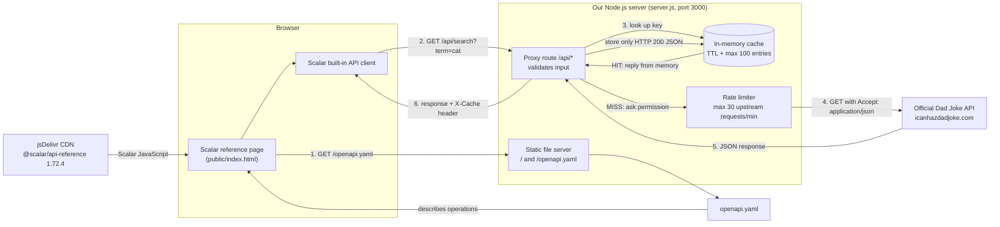
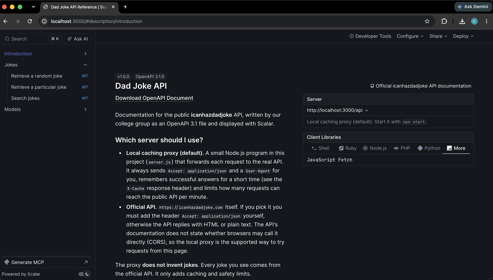
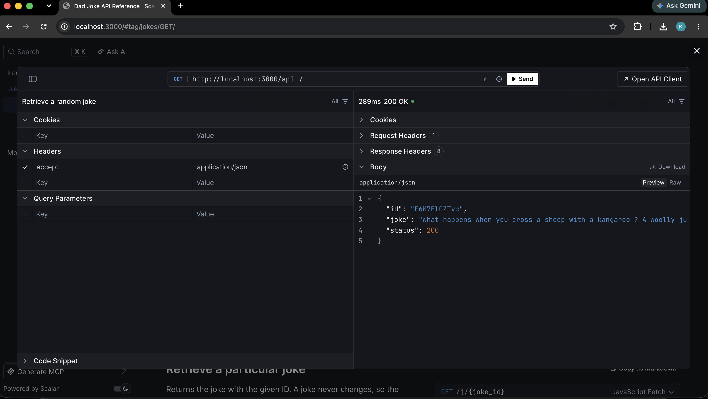
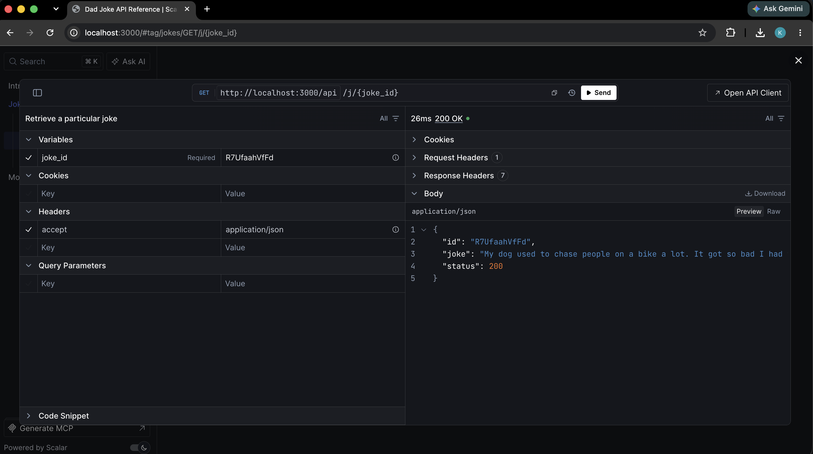
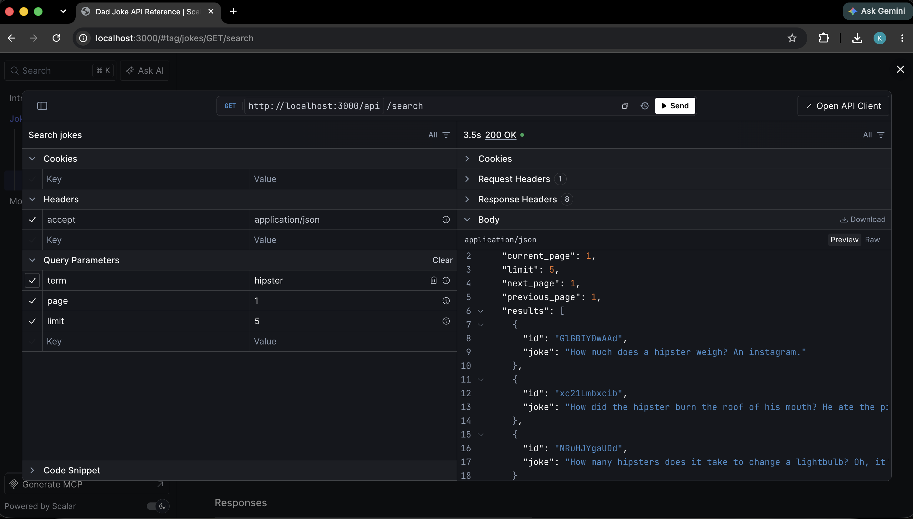
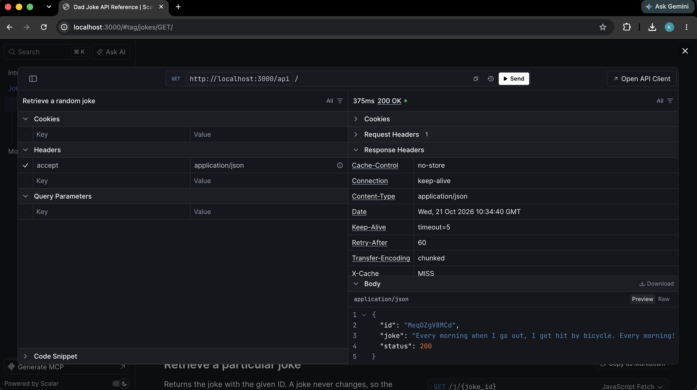
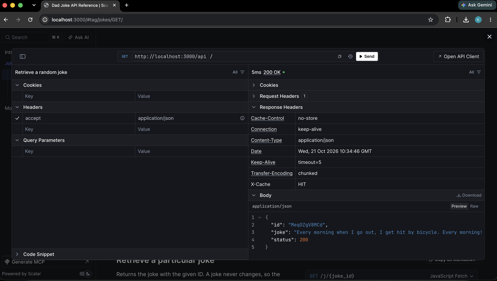

# API Documentation with Scalar

> **Before you submit:** complete every item marked `TODO (group)` in this file. Section 2 (members), section 8
> (screenshots) and section 10 (your own test run on the real API) cannot be completed by anyone but you.

## 1. Project title and topic

**Project:** API Documentation with Scalar — documenting the public *Dad Joke API* (icanhazdadjoke.com).

**In simple terms:** Instead of explaining an API in a messy text file, we described it in one structured file
(an **OpenAPI specification**, `public/openapi.yaml`). A tool called **Scalar** reads that file and draws a clean,
searchable documentation page with a built-in **API client**, so anybody can click *Send* and see a real response from
the real API.

**Assignment objective (all four parts are done):**

1. Generate an OpenAPI specification for an API → `public/openapi.yaml` (3 operations).
2. Render it with Scalar → `public/index.html`.
3. Demonstrate Scalar's built-in API client sending real requests → via our local proxy (see section 4).
4. Explain how Scalar is put together → section 9 and `PROJECT_REPORT.md`.

## 2. Group members

**Divyam Agarwal (E043),**
**Kunaal Kotak (E047),**
**Krishna Patel (E050)**

## 3. Problem statement and objectives

**The problem.** When an API is described only in loose paragraphs, readers must guess: which URLs exist? Which
parameters are required? What does a response look like? Different pages say different things and nothing can be checked
automatically.

**Why a machine-readable specification helps.** An OpenAPI file has a fixed structure, so a program can read it. The same
file can be validated (is it correct and consistent?), turned into documentation, used to generate client code, and
kept as a single source of truth.

**How Scalar makes it interactive.** Scalar reads the OpenAPI file in the browser and builds a reference page from it.
Each operation gets a built-in client where you fill in parameters and send a real request.

**What our group implemented and demonstrates**

* A valid OpenAPI 3.1 file for three operations: random joke, joke by ID, search with pagination.
* A Scalar page that loads that file.
* A small Node.js **proxy with a cache and a rate limit**, so the demo respects the public API's rules.
* 27 automated tests, including tests of the cache (hit, miss, expiry, size limit, errors not cached).

## 4. Architecture diagram

This diagram shows the **real** request flow of the code in this repository.



**What belongs to whom**

| Part | Who built / owns it |
| --- | --- |
| `openapi.yaml`, `index.html`, proxy, cache, rate limiter, tests | **Us** |
| The documentation page and the built-in API client | **Scalar** (open-source library loaded from a CDN) |
| Jokes, search, pagination, the real responses | **The external Dad Joke API** (we never fake them) |

## 5. Technology stack

| Technology | Purpose | Why we chose it |
| --- | --- | --- |
| **OpenAPI 3.1 (YAML)** | Describes the API in a structured way | Industry standard; Scalar understands it; YAML is easy to read |
| **Scalar API Reference 1.72.4** | Renders the spec as docs and provides the API client | Required by the assignment; free, open source, one `<script>` tag |
| **HTML + JavaScript** | The page that starts Scalar | No framework needed |
| **Node.js (≥ 20)** | Runs our small server | Built-in `fetch` and test runner → almost no packages |
| **`node:test`** | Automated tests | Ships with Node, nothing to install |
| `@apidevtools/swagger-parser`, `ajv` | Dev-only: validate the YAML and its examples | Free, widely used validators |
| **Mermaid** | The diagram in this README | GitHub draws it automatically |

All tools are free. No database, framework, account or cloud service is used.

## 6. Project structure

```text
scalar-dad-joke-api/
├── public/
│   ├── index.html        Scalar page: loads the CDN script, points it at /openapi.yaml
│   └── openapi.yaml      The OpenAPI 3.1 specification (the heart of the project)
├── src/
│   ├── app.js            Request handler: static files + /api proxy (routing, validation, caching, forwarding)
│   ├── cache.js          TtlCache: expiry + maximum size (LRU eviction)
│   └── rateLimiter.js    Sliding-window limit on requests sent to the public API
├── server.js             Starts the server (port, host, User-Agent)
├── scripts/validate-spec.js   `npm run validate` – checks the YAML
├── tests/                27 automated tests (cache, proxy, OpenAPI)
├── screenshots/          Screenshots (pending – see PENDING.md)
├── package.json          Scripts and dev dependencies
├── README.md             This file
├── PROJECT_REPORT.md     Longer written report
├── PRESENTATION.md       Slide-by-slide outline for the demo
├── DEMO_CHECKLIST.md     10-minute demo script and pre-demo checks
├── VIVA_QA.md            Practice questions and answers
├── CONTRIBUTION_PLAN.md  Who does what, with commit suggestions
└── .gitignore            Keeps node_modules, .env and other local files out of Git
```

## 7. Prerequisites and setup steps

**Requirements:** macOS, **Node.js 20 or newer** (built and tested with v22), Git, and an **internet connection**
(the page downloads Scalar from a CDN and the proxy contacts the real Dad Joke API).

```bash
# Check Node.js (must print v20.x or higher)
node -v

# 1. Clone the group repository (replace with your own URL)
git clone https://github.com/kunaalkotak/scalar-dad-joke-api.git
cd scalar-dad-joke-api

# 2. Install the dev dependencies (needed for the tests and validator; the server itself needs none)
npm install

# 3. (Optional) check the specification and run the automated tests
npm run validate
npm test

# 4. Start the server
npm start
```

Then open **http://localhost:3000/** in your browser. Use `localhost`, not `127.0.0.1`, because the spec's default server is
`http://localhost:3000/api`. Stop the server with `Ctrl + C`.

**Before the demo (TODO group):** open `server.js` and replace `YOUR-GROUP/scalar-dad-joke-api` in the `USER_AGENT` text with your real
repository URL. The Dad Joke API asks every client to identify itself. Alternatively run
`USER_AGENT="your project (https://github.com/you/repo)" npm start`.

**Different port?** `PORT=4000 npm start` works, but then change the first URL under `servers:` in `public/openapi.yaml` to
`http://localhost:4000/api` (and the matching check in `tests/openapi.test.js`).

No `.env` file is needed: the Dad Joke API has no API key.

## 8. Screenshots

### Overall Scalar API reference

### Random joke request and response

### Specific joke endpoint

### Search endpoint and response

### Caching demonstration (MISS then HIT)



## 9. The four research questions — answered in our own words

> **TODO (group):** these answers were drafted to be accurate and simple. Read each one until you understand it, then
> rewrite it in your own voice. In the viva you must be able to explain it without reading.

### Question 1: What is OpenAPI and how is its specification structured?

**OpenAPI** is a standard way of describing a web API in a file (YAML or JSON) so that both humans and programs can understand it.
It answers: *Where is the API? Which operations exist? What goes in and what comes out?*

Our file `public/openapi.yaml` has these main parts:

| Field | Meaning | In our file |
| --- | --- | --- |
| `openapi` | Which version of the OpenAPI standard we follow | `3.1.0` |
| `info` | Title, version, description of the API | "Dad Joke API", `1.0.0`, plus an explanation of the proxy |
| `externalDocs` | Link to more documentation | The official icanhazdadjoke page |
| `servers` | Base URLs where the API can be called | The local proxy (default) and the official API |
| `tags` | Groups of operations used to organise the page | `Jokes` |
| `paths` | Every URL path and the methods it supports | `/`, `/j/{joke_id}`, `/search`, each with `get` |
| `operationId`, `summary`, `description` | A unique name, a one-line title, a long explanation | e.g. `getRandomJoke`, "Retrieve a random joke" |
| `parameters` | Inputs: path (`joke_id`) or query (`term`, `page`, `limit`) | Defined once under `components` and reused with `$ref` |
| `responses` | What can come back, listed by HTTP status code | `200`, `400`, `404`, `429`, `502`, `504` |
| `content` | The format of a body (here `application/json`) with a `schema` and `examples` | Joke and search responses |
| `components` | A shelf of reusable pieces: `schemas`, `parameters`, `headers`, `responses` | `Joke`, `JokeResponse`, `SearchResponse`, `Error`... |
| `$ref` | A pointer to a reusable piece, so we write it once | `$ref: '#/components/schemas/Joke'` |

A **schema** describes the shape of data: `type: object`, which `properties` exist, which are `required`, and their types
(`string`, `integer`, `array`). For example `SearchResponse.results` is an `array` whose `items` are `Joke` objects.
**Nullable values:** in OpenAPI 3.1 you write `type: [string, 'null']` (in 3.0 it was `nullable: true`). None of the
fields in the official Dad Joke examples is shown as `null`, so we did not mark any field nullable — we did not want to invent a behaviour we
had not seen.

### Question 2: How does Scalar turn a specification into a reference page?

1. The browser loads our `index.html`, which loads Scalar's JavaScript.
2. We call `Scalar.createApiReference('#app', { url: '/openapi.yaml', ... })`. Scalar downloads the file from that URL.
3. Scalar **parses** the YAML into a JavaScript object and resolves the `$ref` pointers, so each operation has its real parameters and schemas.
4. It then **draws** the page from that object: the sidebar comes from `tags` and `paths`, each operation's title and text come from `summary`
   and `description`, the parameter tables from `parameters`, the response and model sections from `responses` and `components.schemas`, and
   code samples and the "Server" list from `servers` and the examples.

Scalar contains no knowledge about jokes. Everything on the page is *computed from the file*. That is why editing the YAML and
refreshing the page changes the documentation (for example, change `maximum: 30` or add a new path and it appears).
The specification is the single source of truth.

### Question 3: How is Scalar embedded?

Scalar supports a **CDN script** (plain HTML, no build step) and **framework integrations** (npm packages, e.g. for
Express, Fastify, ASP.NET, Laravel, or components for Vue/React).

**What we did (CDN script)** in `public/index.html`:

```html
<div id="app"></div>
<script src="https://cdn.jsdelivr.net/npm/@scalar/api-reference@1.72.4"></script>
<script>
  Scalar.createApiReference('#app', { url: '/openapi.yaml', theme: 'purple', layout: 'modern', ... })
</script>
```

* The first `<script>` downloads Scalar and creates a global object named `Scalar`. We pinned version `1.72.4` so the demo doesn't change unexpectedly.
* `createApiReference` takes (1) the CSS selector of the element to fill, and (2) a configuration object.
* **The specification URL is passed as `url`.** It points to our own file, served by `server.js`.

**Comparison.** The CDN way needs no installation and is perfect for a small static page, but it needs internet and the
version is controlled by the URL. A **framework integration** adds Scalar as a dependency of a backend, so the app can generate
the spec itself and serve the docs from the same project; it is more work to set up and ties the docs to that framework. We chose the CDN because
the project has to be simple and explainable.

### Question 4: What does Scalar's built-in API client do?

It is a small version of tools like Postman placed inside the documentation. Using it we:

1. **Choose an endpoint** in the left sidebar (for example *Search jokes*) and open its built-in client (the "Test Request" button).
2. **Check the server** — our default is the local proxy `http://localhost:3000/api`.
3. **Fill in parameters**: e.g. `term = hipster`, `page = 1`, `limit = 5`. Scalar knows which fields exist because they are in the specification.
4. **Press Send.** The client builds a real HTTP request and sends it **from our browser**.
5. **Inspect the real response**: status code, response headers (including our `X-Cache: MISS` / `HIT`) and the JSON body.

Important: **Scalar is only the documentation and client interface.** It is not the Dad Joke API. In our setup the request goes
browser → our proxy → icanhazdadjoke.com, and the jokes come from that external server.


## 10. Rate limits, caching and security

**Public API rules we follow.** The official documentation asks clients to send a custom `User-Agent` (we do, see `server.js`) and does not publish a
numeric request limit. We therefore choose our own conservative limit and never load test the API.

**The proxy reduces requests in three ways**

| Mechanism | Detail |
| --- | --- |
| **Cache** (`src/cache.js`) | Only successful (HTTP 200, JSON) `GET` responses are stored. Random joke **10 s**, joke by ID **1 hour**, search **5 minutes**. |
| **Cache key** | The upstream path plus the query, with `term`, `page`, `limit` always in the same order. `?term=cat` and `?term=dog` are different entries; `?page=2&term=cat` and `?term=cat&page=2` are the same one. |
| **Size limit / eviction** | At most 100 entries. When full, the least recently used entry is removed. Expired entries are deleted when next requested. |
| **Rate limit** (`src/rateLimiter.js`) | At most **30 requests per minute** reach the public API. Cache hits do not count. Beyond that the proxy answers `429` with `Retry-After` and sends nothing upstream. |
| **Input checks** | Only the three documented routes are forwarded; the ID, `term` (≤ 100 chars), `page` and `limit` are checked first. Nothing else can be requested through the proxy. |
| **Timeout** | 8 s, then `504`. Failures and errors are never cached. |

**How to see the cache working:** each proxied response has an `X-Cache: MISS` or `X-Cache: HIT` header, and the server terminal prints a line such as
`[proxy] GET /api/ -> cache HIT`. The proxy also sends `Cache-Control: no-store` so the *browser* does not keep its own copy and hide this.

**Limitations of the cache.** It lives in memory: it is empty after a restart and is not shared between computers. A random joke may repeat for up to 10 s by design.

**Load testing.** **We must never load test, stress test or loop requests against the public API.** The automated tests use a stub and never contact it.

**Secrets policy.** The Dad Joke API needs no key, so this project has **no credentials and no `.env` file**. `.gitignore` already excludes `.env`, `.env.*`, key files and
`node_modules/` in case anyone adds configuration later. Never commit passwords, tokens or keys; if one is committed by accident, treat it as leaked and replace it.

## 11. Limitations and future improvements

* Needs internet twice: for the Scalar script (CDN) and for the Dad Joke API. If either is down the demo fails (the page shows a message if the CDN script fails).
* We depend on a third-party service whose behaviour can change; its docs do not publish rate limits, error bodies or CORS rules.
* The cache is in-memory and single-process. A shared cache (e.g. Redis) would be needed for several servers — deliberately out of scope here.
* Only JSON responses and three operations are documented. Not covered: `text/plain`, the Slack endpoint, the PNG image endpoint and GraphQL.
* The server URL in the spec is fixed to port 3000.
* Possible improvements: self-host the Scalar file to work offline, add the other endpoints, generate the spec from code, run the tests automatically on every push (GitHub Actions).

## 12. References

* Dad Joke API documentation — https://icanhazdadjoke.com/api
* Scalar documentation — https://guides.scalar.com/
* Scalar API Reference, getting started — https://scalar.com/products/api-references/getting-started
* OpenAPI Specification — https://spec.openapis.org/oas/latest.html
* Learn OpenAPI, specification structure — https://learn.openapis.org/specification/structure.html
* Node.js documentation (`fetch`, `node:test`) — https://nodejs.org/docs/latest/api/
* Mermaid diagrams — https://mermaid.js.org/
